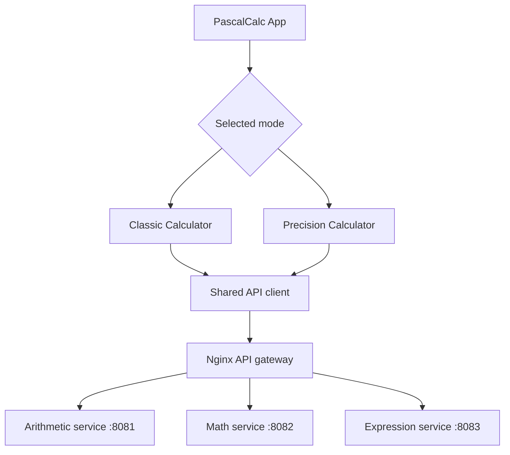
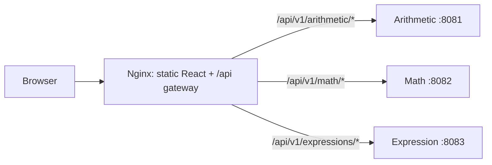

# PascalCalc — UI Design Blueprint

**Document type:** High-level UI/UX design  
**Project:** PascalCalc  
**Tagline:** *Classic inspiration. Modern calculation.*  
**Status:** Product UI blueprint aligned to the approved three-service target architecture; browser verification pending  
**Technology:** React, TypeScript, Vite; Nginx API gateway; three Go microservices

## 1. Purpose and scope

PascalCalc is a browser-based calculator inspired by Blaise Pascal's mechanical calculator, the Pascaline. It offers two complementary interaction models: **Classic Mode**, optimized for keypad-style expression entry, and **Precision Mode**, optimized for explicit selection of a mathematical operation and its operands.

The frontend owns interaction, presentation, input assistance, and HTTP request orchestration. **Go is the source of truth for calculation and expression evaluation.** The application is not designed as a general-purpose symbolic algebra system.

### Supported capabilities

- Arithmetic: addition, subtraction, multiplication, division.
- Mathematical operations: exponentiation (power), square root, percentage.
- Classic expression evaluation with backend operator precedence.
- View switching without a page reload.
- User-facing results, loading state, and error feedback.

## 2. Design principles

1. **Two interaction styles, three reusable calculation services.** Each mode optimizes a different workflow without duplicating mathematical rules.
2. **Separation of concerns.** Components render and manage UI state; a typed API module performs network requests; Go validates and calculates.
3. **Progressive disclosure.** Precision Mode shows only relevant operand fields (one for square root).
4. **Predictable feedback.** Display input, selected operation, result, progress, and errors in recognizable places.
5. **Responsive and accessible by design.** Controls should remain usable with touch, keyboard, and assistive technology.

## 3. Information architecture and navigation



The application starts in **Classic Mode**. A two-option mode selector in the main application switches between Classic and Precision without reloading the page. Both views use a shared API client but maintain their own interaction state.

## 4. Low-fidelity wireframes

These wireframes show intended hierarchy and controls, not pixel-perfect screenshots or a claim about the current CSS.

### 4.1 Classic Mode

```text
+--------------------------------------------------+
|                    PascalCalc                    |
|       Classic inspiration. Modern calculation.  |
|                                                  |
|             [ Classic ] [ Precision ]            |
|                                                  |
| +----------------------------------------------+ |
| |  Completed / current expression              | |
| |                                          125 | |
| +----------------------------------------------+ |
| |   C   |  +/-  |   %   |   ÷                  | |
| |   7   |   8   |   9   |   ×                  | |
| |   4   |   5   |   6   |   −                  | |
| |   1   |   2   |   3   |   +                  | |
| |   √   |   0   |   .   |   =   |   xʸ        | |
| +----------------------------------------------+ |
|   Error / status message (when applicable)       |
+--------------------------------------------------+
```

**Interaction:** Key presses update the current expression or operand. `=` submits an arithmetic/power expression to Go. `√` submits the current numeric operand to the Go square-root endpoint. The display presents the returned result and can retain the completed expression for context.

**Special-key semantics:** `C` clears calculator state; `±` changes the sign of the current operand; `%` follows the calculator's chosen percentage convention; `xʸ` enters exponentiation. The exact semantics of `%`, repeated equals, and editing a completed expression should be checked against the current component and recorded as behavioral decisions.

### 4.2 Precision Mode

```text
+--------------------------------------------------+
|                    PascalCalc                    |
|       Classic inspiration. Modern calculation.  |
|                                                  |
|             [ Classic ] [ Precision ]            |
|                                                  |
|  Choose operation:                               |
|  [ + ] [ − ] [ × ] [ ÷ ] [ xʸ ] [ √ ] [ % ]      |
|          (selected operation highlighted)        |
|                                                  |
|  Operand 1 (maximum 15 digits)                   |
|  [__________________________________________]    |
|                                                  |
|  Operand 2 (maximum 15 digits)                   |
|  [__________________________________________]    |
|  (hidden when square root is selected)           |
|                                                  |
|                 [ Calculate ]                    |
|                                                  |
|  Result:  _______________________                 |
|  Error / status message (when applicable)        |
+--------------------------------------------------+
```

**Interaction:** Select one of seven operation buttons, enter valid operand values, then activate Calculate. The selected operation is visibly differentiated. For square root, hide the second operand and send only the first operand to the backend.

## 5. Frontend component architecture

The following structure reflects the known PascalCalc source organization:

```text
frontend/src/
├── App.tsx                          # Mode selection and page composition
├── App.css
├── components/
│   ├── ClassicCalculator.tsx        # Keypad, expression/display state
│   ├── ClassicCalculator.css
│   └── PrecisionCalculator.tsx      # Operation buttons and operand form
├── api/
│   └── calculatorApi.ts             # Centralized typed HTTP functions
├── config/
│   ├── apiRoutes.ts                 # API endpoint definitions
│   └── appConfig.ts                 # API base URL / timeout configuration
└── main.tsx
```

**Responsibility boundaries:**

| Layer | Owns | Does not own |
|---|---|---|
| `App` | Active mode, page-level composition | Mathematical algorithms |
| `ClassicCalculator` | Key events, expression/display state, request triggers | Expression parsing and precedence rules |
| `PrecisionCalculator` | Operation selection, operands, local feedback | Arithmetic/math implementations |
| `calculatorApi` | HTTP requests, typed responses, transport errors | Visual layout and button state |
| `apiRoutes` / `appConfig` | Endpoint paths and API configuration | Business calculations |
| Nginx gateway | Routing API requests to independently running services | Mathematical rules and UI state |
| Arithmetic / Math / Expression services | Validation, domain operations, expression evaluation | Browser presentation |

## 6. API contract and operation mapping

All listed calculation endpoints use `POST`. In the target deployment, the browser calls same-origin `/api/v1/*` URLs and Nginx routes them to the appropriate Go microservice. During local development, a Vite proxy may provide equivalent routing; verify its configuration when the services are separated.

| User action | Mode | Backend endpoint | API client function |
|---|---|---|---|
| Add | Precision | `/api/v1/arithmetic/add` | `calculateArithmetic('add', a, b)` |
| Subtract | Precision | `/api/v1/arithmetic/subtract` | `calculateArithmetic('subtract', a, b)` |
| Multiply | Precision | `/api/v1/arithmetic/multiply` | `calculateArithmetic('multiply', a, b)` |
| Divide | Precision | `/api/v1/arithmetic/divide` | `calculateArithmetic('divide', a, b)` |
| Power | Precision | `/api/v1/math/power` | `calculateMath('power', a, b)` |
| Square root | Precision | `/api/v1/math/sqrt` | `calculateMath('sqrt', a)` |
| Percentage | Precision | `/api/v1/math/percentage` | `calculateMath('percentage', a, b)` |
| Arithmetic / power expression | Classic | `/api/v1/expressions/evaluate` | `evaluateExpression(expression)` |
| Square root of current operand | Classic | `/api/v1/math/sqrt` | `calculateMath('sqrt', value)` |

**Expression request:**

```json
{ "expression": "2 + 3 * 4" }
```

**Expression response:**

```json
{ "result": 14, "expression": "2 + 3 * 4" }
```

Arithmetic/math requests use numeric operands and return a numeric `result`. The exact payload fields, HTTP status codes, and error JSON shape should be copied from the Go handlers or OpenAPI-style contract when that source is finalized; they are not invented here.

### 6.1 Request flow

```mermaid
sequenceDiagram
    actor User
    participant UI as Calculator component
    participant Client as calculatorApi.ts
    participant Gateway as Nginx API gateway
    participant API as Target Go service
    participant Domain as Calculation package
    User->>UI: Enter values / expression; Calculate
    UI->>UI: UI validation and loading state
    UI->>Client: Typed calculation request
    Client->>Gateway: HTTP POST /api/v1/...
    Gateway->>API: Route by path prefix
    API->>Domain: Validate and calculate
    Domain-->>API: Result or calculation error
    API-->>Gateway: JSON response
    Gateway-->>Client: JSON response
    Client-->>UI: Parsed result or error
    UI-->>User: Display result / error
```

## 7. UI states and input handling

### Classic Mode

- **Editing:** Display the current operand or expression and update it as keypad buttons are pressed.
- **Calculating:** Disable or appropriately manage duplicate submissions while a request is pending.
- **Completed:** Show the returned result; retain the completed expression when available.
- **Error:** Show a clear message without presenting an invalid numeric result.
- **Special operations:** Square root uses the current numeric operand and replaces it with the returned value before further expression evaluation.

### Precision Mode

- **Operation selection:** Indicate which operation is active and show the corresponding input fields.
- **Numeric input:** Permit signed decimal values where valid; enforce the UI's 15-digit operand-entry rule consistently with its documented interpretation.
- **Square root:** Show one operand; reject or report negative inputs as invalid for real-number square root.
- **Submission:** Validate required fields and number conversion before making a request.
- **Response:** Display result or an actionable error, including division by zero or non-finite/invalid input cases.

**Validation ownership:** UI checks help users correct mistakes early. The Go backend must independently enforce input, domain, and expression validity. The UI should not infer that frontend checks make server validation unnecessary.

## 8. Responsive layout and accessibility

**Responsive recommendations:** Center the calculator within a constrained content width on desktop; allow the keypad and form to use available width on mobile; preserve adequately sized touch targets and readable result text. Avoid horizontal scrolling for standard phone widths. Exact breakpoints and CSS behavior require browser verification.

**Accessibility recommendations:**
- Use native buttons for keys and operation selectors.
- Provide accessible labels for operation buttons and operand inputs.
- Expose the selected mode and selected operation programmatically (for example, tab/pressed semantics as appropriate).
- Announce calculation results and errors with appropriate live-region semantics, without repeated announcements during typing.
- Preserve visible keyboard focus and sufficient text/background contrast.
- Support keyboard activation and sensible focus order.

These are design review criteria, not assertions that every accessibility requirement has already been tested.

## 9. Error handling and edge cases

| Scenario | Expected UI treatment | Backend responsibility |
|---|---|---|
| Empty or malformed operand | Inline validation before submit | Reject malformed numeric payload |
| Division by zero | Display readable error, no false result | Reject operation with error response |
| Negative square root | Explain unsupported real-number input | Reject negative value |
| Invalid expression | Preserve input and display useful error | Tokenize, parse, and reject invalid syntax |
| Network error / timeout | Offer retry through a subsequent action | Return when reachable; enforce server timeouts as configured |
| Long numeric values | Apply documented UI entry limit | Validate numeric representation/range |
| Repeated calculation clicks | Prevent unintended duplicate UI actions | Handle independent requests safely |

Percentage semantics, precision/rounding expectations, overflow, and special-key behavior should be explicitly agreed and tested rather than assumed.

## 10. Testing strategy

### Frontend

- Verify initial Classic Mode rendering and switching to Precision Mode.
- Verify keypad entry, expression evaluation requests, and result display.
- Verify square-root requests use the math endpoint.
- Verify selected operation and the single-input square-root layout in Precision Mode.
- Verify success, invalid input, server error, and network error states.
- Use **Vitest + React Testing Library** and mock the API client at component boundaries.

### Backend

- Test arithmetic and math service results and invalid inputs.
- Test expression tokenization, precedence, evaluation, and malformed expressions.
- Test handler JSON contracts and HTTP error responses.
- Use `go test ./...` and `go vet ./...` as verification steps.

**Known project verification at time of drafting:** 12 frontend tests previously passed, and the Vite production build succeeded. This does not by itself certify complete coverage of the cases above. Backend cleanup and final tests should be rerun after changes.

## 11. Design decisions and trade-offs

| Decision | Reason | Trade-off |
|---|---|---|
| Separate Classic and Precision modes | Supports both keypad and explicit-operation workflows | Two sets of interaction state to maintain |
| Centralized typed API client | Reduces coupling between components and HTTP details | Adds a small abstraction layer |
| Go-based expression evaluator | One authoritative implementation of precedence and calculations | Network request required for evaluation |
| Dedicated arithmetic/math endpoints | Clear contracts for explicit operations | More endpoints than a single generic calculate route |
| Dedicated expression endpoint | Supports compound Classic expressions | Additional tokenizer/evaluator logic |
| Conditional second operand | Simplifies square-root interaction | Operation-specific UI branching |
| Client-side validation plus server validation | Better feedback without weakening correctness | Some validation rules appear in both layers |

## 12. Architecture alignment and open decisions

**Aligned with the approved target architecture:** React/TypeScript frontend; two calculator components; central API client and route/config modules; three independently deployable Go services (Arithmetic, Math, Expression); Nginx path-based routing. Existing frontend routes remain stable. Separate service processes and gateway deployment are planned and must be verified after implementation.

**To verify or decide:**
1. Confirm the final HLDs and this blueprint describe the same component boundaries and API payload/error shapes.
2. Verify actual UI branding/tagline, layout, and responsive behavior against the browser implementation.
3. Record precise percentage semantics and the behavior of sign change, power, and repeated equals in Classic Mode.
4. Define the 15-digit rule precisely (digits excluding sign/decimal point versus total characters) and agree on result formatting.
5. Verify accessible navigation and announcements through manual and automated checks.
6. Verify independent service startup and gateway routing after Docker/Nginx are implemented; the diagrams show the approved target design, not completed deployment.

## 13. Deployment and service-routing boundaries



- **Classic Mode** uses Expression for expression evaluation and Math for square root.
- **Precision Mode** uses Arithmetic for basic operations and Math for advanced operations.
- Services are organized by calculation capability, **not** by UI mode.
- The browser does not need to know individual service hostnames or ports.
- No changes to existing frontend endpoint strings are intended; integration tests must confirm this once Nginx is configured.

## 14. Final UI design review checklist

- [x] Two-mode concept and responsibilities documented.
- [x] Known frontend components and API routes mapped.
- [x] Go remains authoritative for calculations and expression evaluation.
- [x] Wireframes, request flow, validation strategy, and testing plan documented.
- [ ] Compare this document against approved HLDs when finalized.
- [ ] Verify actual UI behavior, responsive layout, and accessibility in browsers.
- [ ] Resolve percentage, formatting, and special-key semantics.
- [ ] Rerun all tests after cleanup and record results.

**Review outcome:** This product blueprint is aligned with the selected three-service architecture. Final sign-off follows browser validation, endpoint verification, and closure or acceptance of the outstanding items above.
