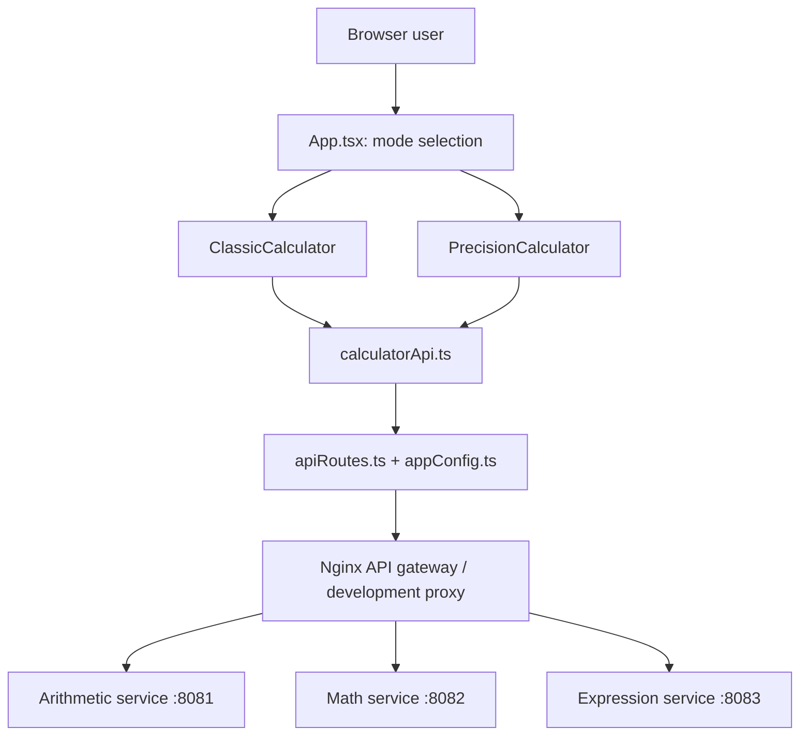
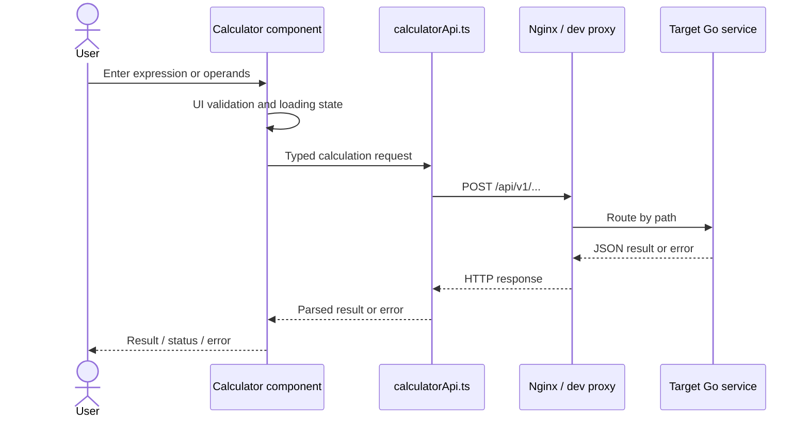

# PascalCalc — Frontend Design (Phase 6)

**Project:** PascalCalc  
**Tagline:** *Classic inspiration. Modern calculation.*  
**Document type:** Frontend architecture and UI/UX design  
**Primary design reference:** `FRONTEND_BLUEPRINT(1).md` — *PascalCalc — UI Design Blueprint*  
**Supplementary reference:** Existing Phase 6 source-derived frontend design baseline and Phase 5 API documentation  
**Scope:** Design documentation only; no changes to application code.

## 1. Purpose and product concept

PascalCalc is a browser-based calculator inspired by Blaise Pascal's Pascaline. It provides two complementary user experiences: **Classic Mode**, a keypad-driven expression calculator, and **Precision Mode**, an explicit-operation calculator with operand fields. The application starts in Classic Mode and switches views without a page reload.

The React frontend owns presentation, input assistance, interaction state, and API orchestration. **Go is authoritative for calculations, validation, expression parsing, and operator precedence.** PascalCalc is not a symbolic algebra system.

Supported operations are addition, subtraction, multiplication, division, power, square root, percentage, and expression evaluation.

## 2. Design principles and architectural boundaries

- Two interaction styles reuse three calculation services; services are separated by capability, not UI mode.
- UI components manage presentation and local state; a centralized typed API client owns HTTP transport.
- Precision Mode reveals only relevant fields; square root requires one operand.
- Results, progress, and errors have predictable display locations.
- Layout and controls should support desktop, mobile, keyboard, touch, and assistive technology; actual conformance remains to be tested.

### High-level component architecture



The diagram represents the **approved target deployment architecture**, not evidence that all independent service and gateway paths have been verified at runtime.

## 3. UI navigation and low-fidelity wireframes

### Classic Mode — initial view

```text
+----------------------------------------------------+
|                     PascalCalc                     |
|       Classic inspiration. Modern calculation.    |
|                                                    |
|              [ Classic ] [ Precision ]             |
| +------------------------------------------------+ |
| | Completed / current expression                 | |
| |                                            125 | |
| +------------------------------------------------+ |
| |    C    |   +/-   |    %    |    ÷              | |
| |    7    |    8    |    9    |    ×              | |
| |    4    |    5    |    6    |    −              | |
| |    1    |    2    |    3    |    +              | |
| |    √    |    0    |    .    |    =    |   xʸ    | |
| +------------------------------------------------+ |
| Status / error message (when applicable)           |
+----------------------------------------------------+
```

The wireframe communicates hierarchy, not pixel-perfect CSS or a claim that every control is currently positioned exactly as shown. Classic keypad interactions build the expression. `=` submits it to the Expression service. `√` sends the current numeric operand to the Math service. `C` clears calculator state. Sign change, percentage, power, repeated equals, and completed-expression editing require explicit behavioral confirmation against the implementation.

**Implementation detail from the existing source-derived baseline:** Classic entry is limited to **256 JavaScript string characters**. The backend independently enforces **1024 UTF-8 bytes** for expressions; these limits measure different things and must not be conflated.

### Precision Mode — explicit-operation view

```text
+----------------------------------------------------+
|                     PascalCalc                     |
|       Classic inspiration. Modern calculation.    |
|                                                    |
|              [ Classic ] [ Precision ]             |
|                                                    |
| Choose operation:                                  |
| [ + ] [ − ] [ × ] [ ÷ ] [ xʸ ] [ √ ] [ % ]         |
|                                                    |
| Operand 1 (maximum 15 digits)                      |
| [______________________________________________]   |
|                                                    |
| Operand 2 (maximum 15 digits)                      |
| [______________________________________________]   |
| (hidden when square root is selected)              |
|                                                    |
|                   [ Calculate ]                    |
| Result: ______________________________              |
| Status / error message (when applicable)           |
+----------------------------------------------------+
```

Seven operation selectors map to Arithmetic or Math. Selecting square root hides the second operand and submits only the first. The existing source-derived design records a **15-numeric-digit limit per operand, excluding sign and decimal point**; verify this interpretation during UI testing. Selected operations must be visually and programmatically distinguishable.

## 4. Frontend source organization and responsibilities

```text
frontend/src/
├── main.tsx
├── App.tsx
├── App.css
├── index.css
├── components/
│   ├── ClassicCalculator.tsx
│   ├── ClassicCalculator.css
│   └── PrecisionCalculator.tsx
├── api/
│   └── calculatorApi.ts
└── config/
    ├── apiRoutes.ts
    └── appConfig.ts
```

| Layer | Responsibility | Explicitly excluded |
|---|---|---|
| `App.tsx` | Application shell and Classic/Precision mode selection | Mathematical algorithms |
| `ClassicCalculator.tsx` | Keypad, expression/display state, request triggers, feedback | Parsing precedence and arithmetic rules |
| `PrecisionCalculator.tsx` | Operation selection, operands, local validation, feedback | Domain calculation algorithms |
| `calculatorApi.ts` | Typed JSON requests, transport errors, timeout | Layout and keypad state |
| `apiRoutes.ts`, `appConfig.ts` | Endpoint paths, API base URL, timeout | Calculation logic |
| Nginx | Static frontend hosting and API path routing in target deployment | UI state and math rules |
| Go services | Validation, calculations, expression evaluation | Browser presentation |

State is local to components via React hooks; no global state library is required for the documented two-mode workflow. The existing design baseline identifies React 19, TypeScript 6, and Vite 8; these versions should be reconfirmed against the package manifest when preparing Phase 7.

## 5. API contract and operation routing

The browser uses same-origin `/api/v1/*` routes in the target deployment. Nginx forwards requests by capability; a Vite proxy may be used locally. The source-derived frontend baseline specifies `VITE_API_BASE_URL` (default `/api`) and `VITE_API_TIMEOUT_MS` (default 10000 ms). These are implementation observations, not values mandated by the blueprint.

| User action | Mode | POST endpoint | Client function |
|---|---|---|---|
| Add | Precision | `/api/v1/arithmetic/add` | `calculateArithmetic('add', a, b)` |
| Subtract | Precision | `/api/v1/arithmetic/subtract` | `calculateArithmetic('subtract', a, b)` |
| Multiply | Precision | `/api/v1/arithmetic/multiply` | `calculateArithmetic('multiply', a, b)` |
| Divide | Precision | `/api/v1/arithmetic/divide` | `calculateArithmetic('divide', a, b)` |
| Power | Precision | `/api/v1/math/power` | `calculateMath('power', a, b)` |
| Square root | Precision | `/api/v1/math/sqrt` | `calculateMath('sqrt', a)` |
| Percentage | Precision | `/api/v1/math/percentage` | `calculateMath('percentage', a, b)` |
| Evaluate expression | Classic | `/api/v1/expressions/evaluate` | `evaluateExpression(expression)` |
| Square root of current operand | Classic | `/api/v1/math/sqrt` | `calculateMath('sqrt', value)` |

**Example — expression evaluation**

Request:
```json
{"expression":"2 + 3 * 4"}
```

Expected successful response:
```json
{"result":14,"expression":"2 + 3 * 4"}
```

**Example — arithmetic division**

Request:
```json
{"a":12,"b":3}
```

Expected successful response:
```json
{"result":4}
```

The exact error envelope, status codes, and server validation behavior must follow the Go handlers and **Phase 5 `API_DOCUMENTATION.md`**; these example payloads do not establish live endpoint verification. The old generic `/api/v1/calculate` route must not be treated as implemented merely because it is declared as a constant.

### Request sequence



## 6. Interaction state and validation

| State | Classic Mode | Precision Mode |
|---|---|---|
| Editing | Keypad updates current expression/operand | Enter signed decimal operands |
| Selection | Keypad action and current expression | Highlight selected operation |
| Calculating | Avoid duplicate `=` submissions | Disable/guard Calculate while pending |
| Completed | Show result and optionally completed expression | Show numeric result |
| Error | Preserve useful input and show readable error | Show validation or server error |
| Clear / reset | `C` resets calculator state | Operand/operation reset as implemented |

Client validation helps users correct errors quickly, but backend validation remains mandatory. Precision Mode should check required fields, finite numeric conversion, division by zero, and negative real square-root input before sending a request. Backend errors remain authoritative.

The source-derived design describes a centralized `postJson<T>()` helper using JSON `fetch`, `AbortController` timeout, and parsed API errors. Non-JSON gateway errors and request cancellation on unmount remain review items, not approved code changes.

## 7. Responsive and accessible experience

**Target behavior:** centered, readable calculator on desktop; usable keypad and form on mobile; no routine horizontal scrolling at phone widths; adequate touch targets; visible focus indicators and readable results. Exact CSS breakpoints and browser behavior remain unverified.

**Accessibility review criteria:** native interactive controls, labeled inputs and operations, exposed selected mode/operation, keyboard operation, sensible focus order, live announcements for results and errors, and sufficient contrast. The earlier source-derived design identifies `aria-pressed`, `role="status"`, and `role="alert"` usage; their correctness and actual assistive-technology behavior still need testing.

## 8. Error handling and edge cases

| Scenario | UI treatment | Backend role |
|---|---|---|
| Missing/malformed operand | Show inline feedback; do not submit | Reject malformed payload |
| Division by zero | Show readable error; no false result | Return domain error |
| Negative square root | Explain unsupported real input | Reject invalid domain |
| Invalid expression | Preserve expression; show useful error | Tokenize, parse, reject |
| Timeout/network failure | Show actionable message; permit subsequent retry | Serve requests when reachable |
| Overlong expression/operand | Enforce UI-specific limits | Enforce independent server constraints |
| Repeated submit | Guard while pending | Process independent requests safely |
| Non-finite/overflow/rounding | Do not show misleading values | Define numeric constraints and semantics |

Percentage interpretation, repeated equals, sign change, completed-expression editing, rounding, and overflow behavior must be verified and documented as explicit decisions, rather than inferred from wireframes.

## 9. Testing strategy and acceptance evidence

Frontend tests should use **Vitest and React Testing Library**, mocking the API client at component boundaries. Cover default Classic rendering, mode switching, keypad entry, expression evaluation, Classic square root routing, Precision operation selection, one-operand square root, valid and invalid inputs, loading, server failures, and network failures.

Backend/API checks should cover domain operations, expression precedence and invalid syntax, handler JSON contracts, and error status codes. Integration checks must verify independent service startup and Nginx path-based routing once deployed.

The uploaded blueprint reports **12 frontend tests previously passed and a successful Vite production build** at its drafting time. This is historical project evidence stated by the blueprint, **not a test run performed as part of this document update**.

## 10. Design decisions, assumptions, and trade-offs

| Decision | Rationale | Trade-off / status |
|---|---|---|
| Separate Classic and Precision components | Tailored interaction workflows | Separate local states; blueprint decision |
| Centralized typed API client | Consistent contracts and errors | Shared dependency; blueprint decision |
| Go expression evaluation | Single precedence/calculation authority | Network dependency; blueprint decision |
| Three independently deployable Go services | Clear calculation capability boundaries | More deployment and routing complexity; target architecture |
| Conditional operand 2 | Simpler square-root flow | Operation-specific UI branching; blueprint decision |
| Client + server validation | Early feedback and authoritative correctness | Some duplicated rules; blueprint decision |
| Local React state | Keeps small UI simple | May change if cross-mode features grow; source-derived observation |
| 256-character Classic / 15-digit Precision UI limits | Bounded input | Must be verified against implementation and tests; source-derived observations |

## 11. Open decisions and formal design review

1. Confirm the blueprint, backend HLD, and Phase 5 API documentation agree on payloads and error contracts.
2. Verify actual branding, tagline, key layout, responsiveness, and browser behavior against the low-fidelity wireframes.
3. Decide or verify Classic `%`, `±`, power, repeated equals, and post-result editing semantics.
4. Confirm the 15-digit rule and numeric formatting/precision requirements.
5. Test keyboard, touch, focus, result/error announcements, and contrast.
6. Verify independent Arithmetic (`8081`), Math (`8082`), and Expression (`8083`) services behind Nginx; these ports are target architecture details.
7. Re-run frontend tests and production build in the actual project environment before Phase 7 sign-off.


