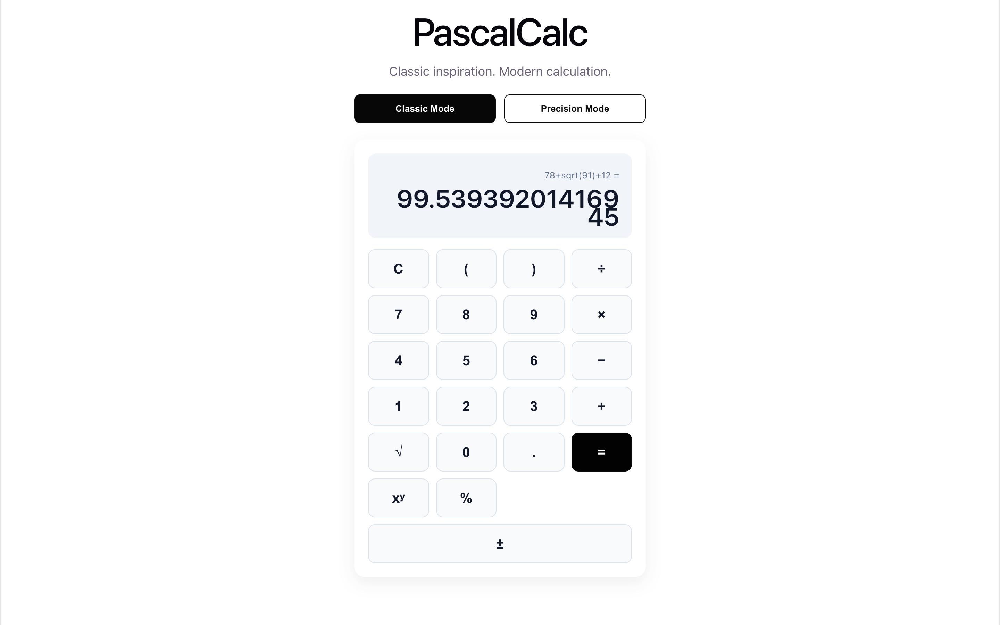
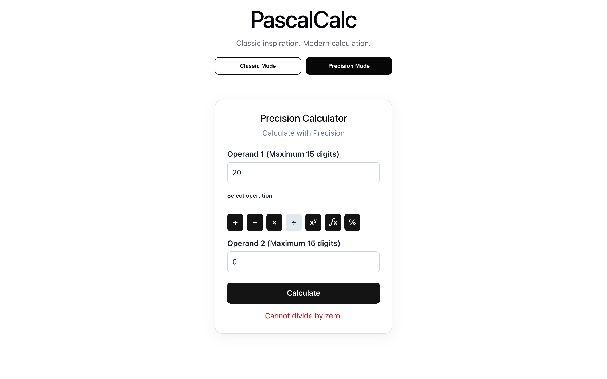
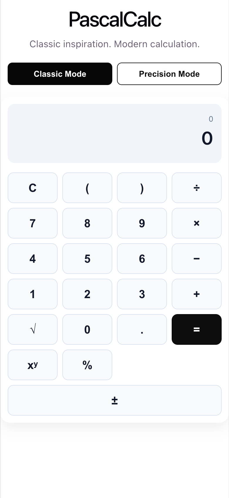
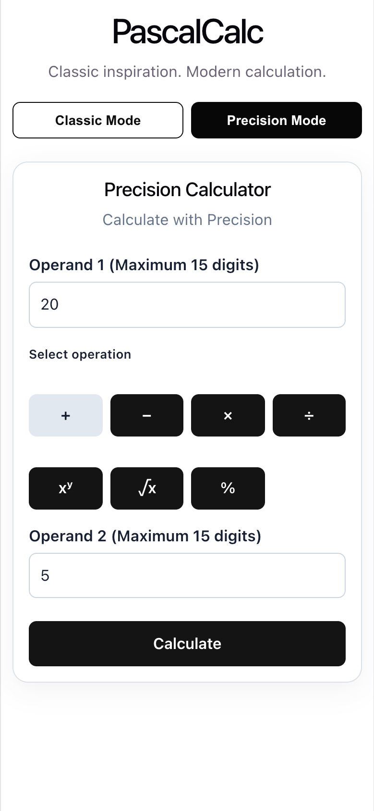

# PascalCalc — Unit Test and Coverage Report

**Project:** PascalCalc  
**Report date:** 19 October 2026  
**Scope:** Go backend microservices, React/TypeScript frontend, REST APIs, and Docker deployment  
**Evidence status:** Backend and frontend unit-test results and coverage are confirmed by developer-provided terminal output from 19 October 2026. Responsive browser behavior was confirmed by the developer after CSS fixes; screenshots have not yet been provided for inclusion. Docker deployment results were confirmed during the earlier developer walkthrough.

## 1. Testing objectives and scope

The objective is to document automated unit testing, code coverage, reproducible execution steps, and remaining verification gaps for PascalCalc's submission deliverable **“Unit tests and coverage report.”**

The test scope includes:

- **Backend:** Arithmetic, Math, and Expression calculation logic; HTTP handlers; configuration; and service routing.
- **Frontend:** React Classic and Precision interfaces, rendering, user interactions, and API success/failure handling, to the extent covered by the existing test files.
- **Integration/smoke verification:** REST requests through Nginx, Docker container startup, gateway health, and manual browser calculations.

Automated unit tests live in source files; this document is a summary, not a substitute for runnable tests or generated coverage artifacts. Smoke checks are distinguished from unit tests.

## 2. Backend unit tests and test scenarios

### 2.1 Test source locations

The supplied PascalCalc project archive includes these backend test files:

| Area | Test file |
| --- | --- |
| Arithmetic business logic | `backend/internal/arithmetic/service_test.go` |
| Arithmetic HTTP handler | `backend/internal/arithmetic/handler_test.go` |
| Math business logic | `backend/internal/mathops/service_test.go` |
| Math HTTP handler | `backend/internal/mathops/handler_test.go` |
| Expression tokenizer | `backend/internal/expression/tokenizer_test.go` |
| Expression evaluator | `backend/internal/expression/evaluator_test.go` |
| Expression HTTP handler | `backend/internal/expression/handler_test.go` |
| Configuration | `backend/internal/config/config_test.go` |
| Service configuration | `backend/internal/config/service_test.go` |
| HTTP router | `backend/internal/server/router_test.go` |
| Service routing | `backend/internal/server/services_test.go` |

These locations establish the presence of test files; individual test-case pass/fail claims require execution of the commands below.

### 2.2 Test scenarios

| Area | Representative scenarios to verify |
| --- | --- |
| Arithmetic | Basic operations; division by zero; invalid numeric inputs |
| Math | Square root, power, and percentage operations; invalid domains and boundaries |
| Expression | Tokenization; precedence; parentheses; unary operators; malformed expressions |
| HTTP handlers | Valid JSON, validation failures, error responses, unsupported methods |
| Configuration and routing | Defaults, service-specific settings, and endpoint registration |

These are the intended verification categories inferred from the project test areas and API contract, **not an assertion that every individual scenario is covered by an existing passing test**. Check individual `*_test.go` files to confirm exact cases.

## 3. Frontend unit tests and test scenarios

### 3.1 Test source locations

The supplied project archive includes:

- `frontend/src/App.test.tsx`
- `frontend/src/components/ClassicCalculator.test.tsx`

Frontend testing uses **Vitest**, **React Testing Library**, and the V8 coverage provider.

### 3.2 Confirmed frontend test results

| Metric | Reported result |
| --- | ---: |
| Test files | 2 passed |
| Unit tests | 14 passed / 14 total |
| Statement coverage | **84.44%** |
| Branch coverage | 74.13% |
| Function coverage | 86.95% |
| Line coverage | 85.93% |

**Source of figures:** Developer-provided `npm run test -- --run --coverage` output, 19 October 2026, after the responsive CSS changes. Vitest v5.0.5 reported 2 passing files and 14 passing tests in 8.60 seconds.

### 3.3 Frontend test scenarios

| Area | Representative scenarios to verify |
| --- | --- |
| Rendering | Calculator UI loads and displays expected controls |
| Interaction | Number/operator entry and calculation flow |
| API integration | Successful result rendering and backend error handling |
| Validation | Invalid input and maximum-length behavior |
| Modes | Classic and Precision workflows |

The current output explicitly confirms Classic Mode tests for the 256-character boundary, `sqrt(` length counting, sign-change length protection, and rejection of oversized expressions. The output does not establish dedicated Precision Mode component tests; confirm other scenario coverage by inspecting the test files.

### 3.4 Browser functional testing — screenshot evidence

### 3.4 Browser Functional Testing

The PascalCalc application was tested in Google Chrome
using desktop and mobile viewport configurations.

The following screenshots demonstrate successful
calculations in both Classic and Precision modes.

#### Classic Mode — Desktop



#### Precision Mode — Desktop



#### Classic Mode — Mobile



#### Precision Mode — Mobile


```

### 3.5 Responsive UI test results

Use Chrome DevTools Device Toolbar (macOS: `Cmd + Option + I`, then `Cmd + Shift + M`) or equivalent browser tools. Test both modes at each viewport and record **Pass / Fail** only after performing the checks.

| Viewport | Dimensions (CSS px) | Classic Mode | Precision Mode | Layout / interaction observations |
| --- | --- | --- | --- | --- |
| Desktop | 1440 × 900 | Pass (developer-confirmed layout) | Pass (developer-confirmed layout) | Developer confirmed desktop presentation after CSS fixes; exact viewport dimensions not independently captured |
| Tablet | 768 × 1024 | Pending | Pending | No explicit test result supplied |
| Mobile | 390 × 844 | Pass (developer-confirmed) | Pass (developer-confirmed) | Initial overflow corrected; developer confirmed working layout |
| Small mobile | 320 × 568 | Pending | Pending | No explicit test result supplied |

**Pass criteria:** No unintended horizontal scrolling; buttons and inputs remain visible and operable; calculation results remain readable; mode switching and calculations work in both modes. Record any overflow, clipping, or touch-target issues in the observations column.

## 4. Coverage results

**Execution evidence:** The developer ran the following commands on 19 October 2026 and supplied their terminal output:

- Backend: `go test ./... -count=1 -coverprofile=coverage.out` and `go tool cover -func=coverage.out`
- Frontend: `npm run test -- --run --coverage`

### 4.1 Backend coverage by package

| Go package | Statement coverage | Test result |
| --- | ---: | --- |
| `internal/arithmetic` | 88.1% | Pass |
| `internal/config` | 68.1% | Pass |
| `internal/expression` | 91.3% | Pass |
| `internal/mathops` | 87.1% | Pass |
| `internal/server` | 43.1% | Pass |
| **Overall (instrumented packages)** | **80.4%** | **Pass** |

The command-entry packages under `cmd/` and `internal/api` displayed `[no test files]`. The backend output showed no test failures. Function-level gaps include `config.LoadDotEnv` (0%) and `server.Run` (0%).

### 4.2 Frontend coverage

| Metric | Confirmed coverage |
| --- | ---: |
| Statements | **84.44%** |
| Branches | 74.13% |
| Functions | 86.95% |
| Lines | 85.93% |
| Test files | **2 passed / 2 total** |
| Tests | **14 passed / 14 total** |

Test files: `src/App.test.tsx` (5 tests) and `src/components/ClassicCalculator.test.tsx` (9 tests). CSS files appear as 0% in the V8 file listing; the overall coverage percentages are taken directly from the Vitest `All files` row.

**Interpretation:** Coverage is a measurement of executed statements and branches, not a guarantee of correctness. Additional server lifecycle and conditional-path tests would improve coverage.

## 5. Commands to reproduce testing

Run these commands from the PascalCalc repository root. Capture the output on the final committed revision to refresh the report's figures.

### 5.1 Backend unit tests and coverage

```bash
cd backend
go test ./... -count=1 -coverprofile=coverage.out
go tool cover -func=coverage.out
go tool cover -html=coverage.out -o coverage.html
```

`-count=1` avoids cached results. The `total:` line from `go tool cover -func=coverage.out` reports overall statement coverage. The confirmed backend result from the supplied terminal output was **80.4%**.

### 5.2 Frontend unit tests and coverage

```bash
cd frontend
npm ci
npm run test -- --run
npm run test -- --run --coverage
npm run build
```

The Vitest coverage output supplies statement, branch, function, and line coverage. `npm run build` checks production compilation and is **not** a unit test.

### 5.3 REST API smoke-test examples

With the Docker Hub deployment running on port `8089` (or substitute `8088` for the default port), test the public API through Nginx.

### Arithmetic — addition

```bash
curl -i -X POST http://localhost:8089/api/v1/arithmetic/add \
  -H 'Content-Type: application/json' \
  -d '{"a":10,"b":20}'
```

Expected success payload: `{"result":30}`.

### Math — square root

```bash
curl -i -X POST http://localhost:8089/api/v1/math/sqrt \
  -H 'Content-Type: application/json' \
  -d '{"a":16}'
```

Expected success payload: `{"result":4}`.

### Expression — precedence

```bash
curl -i -X POST http://localhost:8089/api/v1/expressions/evaluate \
  -H 'Content-Type: application/json' \
  -d '{"expression":"2+3*4"}'
```

Expected result: `14`, with the expression included in the response.

### Negative case — division by zero

```bash
curl -i -X POST http://localhost:8089/api/v1/arithmetic/divide \
  -H 'Content-Type: application/json' \
  -d '{"a":10,"b":0}'
```

Expected: HTTP `400` with a JSON error response.

**Execution status:** These are reproducible checks and expected API contracts from the existing documentation. Their individual `curl` outputs have not been supplied for the recent Docker Hub run; do not mark them passed without running them.

## 6. Known limitations and test gaps

1. **Final commit verification:** Both test suites passed in the supplied 19 October 2026 run. Re-run if code changes after this execution or before tagging a release.
2. **Capture API smoke-test responses** for Arithmetic, Math, and Expression through the Docker Hub gateway; browser functionality was confirmed, but individual POST results were not recorded here.
3. **Verify numeric input constraints:** The design specifies a 15-digit operand limit; confirm actual enforcement and boundary tests before claiming implementation compliance.
4. **Expression limit coverage:** Frontend tests confirm the 256-character Classic Mode boundary, including overflow cases. The Go Expression Service defaults to a 1024-UTF-8-byte limit; confirm explicit backend boundary and malformed/oversized-request test coverage.
5. **Expand conditional/error-path tests** where useful, especially frontend branches (74.13%), server lifecycle (`Run`: 0%), and `.env` loading (`LoadDotEnv`: 0%).
6. **Responsive test evidence:** Capture four actual desktop/mobile browser screenshots and explicitly test tablet (768 × 1024) and small-mobile (320 × 568) viewports.
7. **Publish an AMD64 frontend image** if prebuilt Docker Hub deployment must support Intel/AMD hosts without building from source.

## 7. Test execution summary

| Verification | Result | Evidence classification |
| --- | --- | --- |
| Go backend unit tests and coverage | **Passed; 80.4% statement coverage** | Developer-provided terminal output, 19 October 2026 |
| React frontend unit tests | **14/14 passed**, 2 test files | Developer-provided terminal output, 19 October 2026 |
| React statement coverage | **84.44%** | Developer-provided terminal output, 19 October 2026 |
| React branch / function / line coverage | **74.13% / 86.95% / 85.93%** | Developer-provided terminal output, 19 October 2026 |
| Docker Hub containers | All four containers running | Confirmed developer walkthrough |
| Nginx gateway health | HTTP success; `{"status":"ok","component":"gateway"}` | Confirmed developer walkthrough |
| Frontend and calculations | Loaded and working in browser | Developer manual confirmation |
| Individual POST API smoke tests | Not captured for the latest deployment | Pending |
| Four browser screenshots | Not yet supplied | Pending capture |
| Responsive browser layouts | Desktop and 390 × 844 mobile confirmed working after CSS fixes | Developer manual confirmation; tablet/small mobile pending |

**Conclusion:** The supplied 19 October 2026 terminal output confirms passing backend tests (80.4% overall statement coverage) and frontend tests (14/14 passing; 84.44% statement coverage). The Docker Hub deployment previously passed startup and browser smoke checks, and the developer confirmed responsive CSS fixes. Remaining submission evidence includes the four actual browser screenshots, tablet/small-mobile checks, and explicit API POST smoke-test responses. Re-run automated tests if further source changes are made.

### Docker Hub deployment details

**Environment:** Developer's Apple Silicon Mac; Docker Compose project `pascalcalc-hub`, host port `8089`.

Published images used:

| Container/service | Image |
| --- | --- |
| Arithmetic | `sandipain/pascalcalc-arithmetic:1.0` |
| Math | `sandipain/pascalcalc-math:1.0` |
| Expression | `sandipain/pascalcalc-expression:1.0` |
| Frontend + Nginx | `sandipain/pascalcalc-web:1.0-arm64` |

### 7.1 Confirmed deployment checks

| Check | Observed result | Status |
| --- | --- | --- |
| `docker compose -f compose.hub.yaml ps` | All four published-image containers reported `Up` | **Passed** |
| `curl http://localhost:8089/health` | `{"status":"ok","component":"gateway"}` | **Passed** |
| Open `http://localhost:8089/` | Frontend loaded in browser | **Passed** |
| Perform browser calculations | Developer confirmed calculations work | **Passed (manual confirmation)** |
| `GET /api/v1/math/health` | HTTP `404` | **Not a valid proof of failure**; this URL is not a documented calculation route |
| `GET /api/v1/expressions/health` | HTTP `404` | **Not a valid proof of failure**; this URL is not a documented calculation route |
| Direct POST smoke tests for all three APIs | Results not yet captured for this deployment | **Pending explicit evidence** |

**Platform limitation:** All three backend images were verified as multi-platform (`linux/amd64`, `linux/arm64`). The published frontend image used in this deployment is ARM64-specific; the prebuilt-image Compose deployment is therefore currently documented for ARM64 hosts. AMD64 reviewers can use the source-build deployment.

### 7.2 Reproduce Docker Hub deployment

```bash
docker compose -f compose.hub.yaml config --quiet
docker compose -f compose.hub.yaml pull
PASCALCALC_PORT=8089 docker compose -f compose.hub.yaml up -d
docker compose -f compose.hub.yaml ps
curl http://localhost:8089/health
```

Stop the deployment:

```bash
docker compose -f compose.hub.yaml down
```


### 7.3 Evidence and repository references

- **Source tests:** `backend/internal/**/*_test.go`, `frontend/src/**/*.test.tsx`
- **Run instructions:** `README.md`, section *Testing and code coverage*
- **API contract:** `docs/API_DOCUMENTATION.md`
- **Docker deployment:** `compose.yaml`, `compose.hub.yaml`, `DOCKER_SETUP.md`
- **Project repository:** https://github.com/sandipa1982/pascalcalc

### Suggested submission evidence

The 19 October 2026 terminal outputs have been incorporated into the coverage tables. If the source changes, regenerate the coverage profiles locally and update these results. Commit the report and the unit-test source files. Generated reports may be committed if small and useful, but build artifacts and temporary files should remain excluded unless intentionally included as submission evidence.

---

**Reporting integrity:** “Passed” refers to developer-supplied terminal results or clearly labeled manual confirmation. “Pending” means final evidence was not supplied. No tests were executed by the report author; the automated-test results are transcribed from the developer’s actual terminal output.
