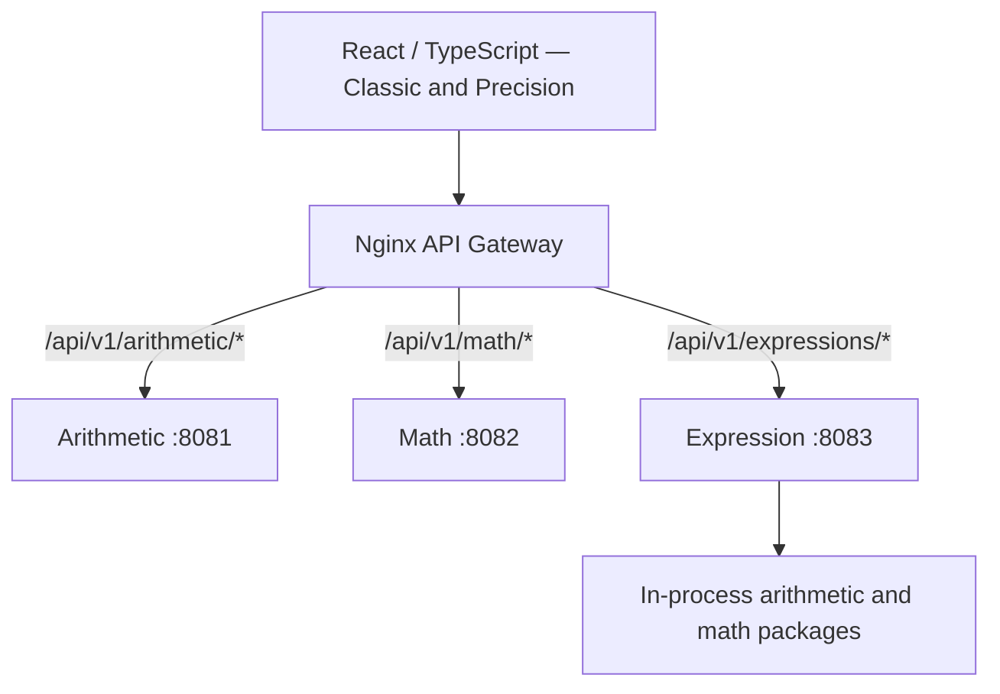
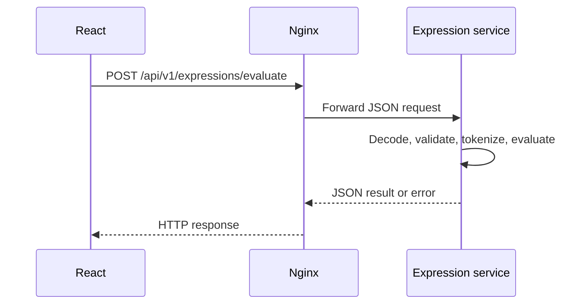

# PascalCalc — Backend High-Level Design

**Phase:** 3 — Backend Design  
**Status:** Draft for review  
**Architecture:** Three independently deployable Go REST microservices

## 1. Purpose and scope

Define the backend service boundaries, shared components, public contracts, validation strategy, runtime configuration, and verification criteria for PascalCalc. The approved architecture comprises Arithmetic, Math, and Expression services. The frontend communicates through Nginx using versioned JSON APIs.

The backend is stateless. Authentication, persistent storage, message brokers, and distributed transactions are outside the initial scope.

## 2. Logical architecture



The Expression service reuses Go calculation packages in-process, rather than calling the other services over HTTP. Compile-time source sharing does not imply shared runtime processes.

## 3. Service responsibilities

| Service | Responsibility | Public API prefix | Default service port |
|---|---|---|---:|
| Arithmetic | Addition, subtraction, multiplication, division | `/api/v1/arithmetic/` | 8081 |
| Math | Power, square root, percentage | `/api/v1/math/` | 8082 |
| Expression | Tokenization, parsing, precedence, expression evaluation | `/api/v1/expressions/` | 8083 |

Each service owns an independent executable, router, HTTP listener, configuration, and `GET /health` endpoint.

## 4. Go module and component design

```text
backend/
├── cmd/
│   ├── arithmetic-api/main.go
│   ├── math-api/main.go
│   └── expression-api/main.go
├── internal/
│   ├── api/            # API route and operation constants
│   ├── arithmetic/     # Arithmetic handlers, domain logic, tests
│   ├── mathops/        # Math handlers, domain logic, tests
│   ├── expression/     # Expression handler, tokenizer, evaluator, tests
│   ├── config/         # Environment-based runtime configuration
│   └── server/         # Service-specific routers and lifecycle
└── go.mod
```

A single Go module simplifies shared code maintenance. Services are independently built and run; dependencies between packages are local, not service-to-service network calls.

## 5. API contracts

Calculation endpoints accept `POST` requests with JSON and return JSON.

| Endpoint | Example request | Example response |
|---|---|---|
| `/api/v1/arithmetic/add` | `{"a":2,"b":3}` | `{"result":5}` |
| `/api/v1/arithmetic/subtract` | `{"a":5,"b":3}` | `{"result":2}` |
| `/api/v1/arithmetic/multiply` | `{"a":2,"b":3}` | `{"result":6}` |
| `/api/v1/arithmetic/divide` | `{"a":6,"b":3}` | `{"result":2}` |
| `/api/v1/math/power` | `{"a":2,"b":3}` | `{"result":8}` |
| `/api/v1/math/sqrt` | `{"a":9}` | `{"result":3}` |
| `/api/v1/math/percentage` | `{"a":50,"b":10}` | `{"result":...}` — semantics specified by Math service |
| `/api/v1/expressions/evaluate` | `{"expression":"2 + 3 * 4"}` | `{"expression":"2 + 3 * 4","result":14}` |

Each service provides `GET /health` returning `{"status":"ok"}`. Health endpoints are service-local; the gateway need not expose an ambiguous shared health route. Full status-code and error-message inventories belong to the API reference derived from the handlers.

## 6. Request processing



Classic Mode primarily submits expressions to the Expression service. Precision Mode submits operand-based operations to Arithmetic or Math. Both modes use a centralized frontend API client and stable gateway routes.

## 7. Validation and error strategy

- Enforce HTTP methods at handlers and reject malformed or unexpected JSON fields.
- Enforce maximum request-body size and required operands.
- Reject division by zero, invalid real-number square roots, invalid expressions, and non-finite results.
- Create expression evaluators per request to isolate mutable parser state.
- **Backend expression-length requirement: maximum 1024 bytes of UTF-8 input.** Enforce independently of the frontend 256-character UI limit, with backend configuration and deployment using the 1024-byte default.
- **Classic Mode input requirement: maximum 15 digits per numeric operand.** The frontend owns the interaction rule; backend validation remains authoritative for its published API constraints.
- Return structured application errors and appropriate HTTP statuses. Gateway-generated upstream errors may use a different representation.

The frontend 256-character measurement semantics and 15-digit operand counting behavior require frontend verification. Backend byte-length enforcement and normalization/trim behavior require source and boundary-test verification.

## 8. Runtime configuration and lifecycle

Service configuration includes host, port, request-body limit, expression-length limit, and HTTP read/write/idle timeouts. Services support graceful shutdown on termination signals. No service depends on another service's process for startup or calculation execution.

Nginx routes the three public API prefixes to their respective services without rewriting the API path. Docker Compose defines separate backend services and the web gateway. Local development may start the services separately and use a Vite proxy for API requests.

## 9. Testing strategy and acceptance criteria

- Unit tests cover mathematical operations, parser precedence, unary operators, percentages, and invalid input.
- Handler tests cover methods, request JSON, missing operands, response shapes, and status codes.
- Configuration tests cover invalid values and defaults.
- Backend boundary tests cover expression payload lengths of 1024 and 1025 UTF-8 bytes, including multibyte characters. Frontend boundary tests cover 256 and 257 characters and Classic Mode 15 and 16 digits.
- Integration tests verify gateway routing, service health, and unaffected routes during one-service outages.
- Docker Compose smoke tests verify service startup, calculation routes, and clean shutdown.
- Report measured coverage only from executed coverage commands; do not infer coverage percentages.

## 10. Design decisions and trade-offs

| Decision | Rationale | Trade-off |
|---|---|---|
| Three deployable services | Capability-based ownership | More operational components |
| One shared Go module | Reuse domain logic and reduce duplication | Coordinated source changes |
| In-process expression dependencies | Avoid network calls for arithmetic inside evaluation | Compile-time coupling |
| Nginx gateway | Stable browser-facing routes | Additional routing layer |
| Stateless operations | No persistence required | No calculation history |
| Configurable limits and timeouts | Bounded request processing | Requires consistent environment configuration |

## 11. Related documents

- [Solution Approach](SOLUTION_APPROACH.md) — Phase 1 requirements and constraints
- [System Architecture](architecture.md) — Phase 2 architecture decisions
- [Architecture Prompts](design_prompts.md) — Phase 2 design prompt sequence
