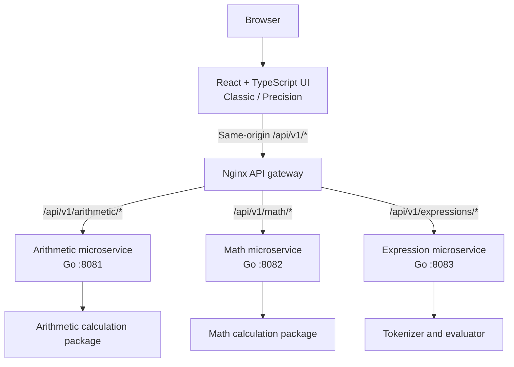
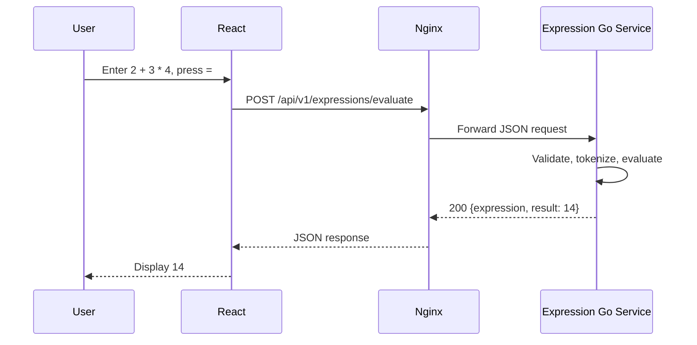

# PascalCalc — System Architecture

**Project:** PascalCalc  
**Document:** Phase 2 — System Architecture  
**Status:** Architecture design for review  
**Technology:** React, TypeScript, Vite, Go, Nginx, Docker Compose

## 1. Purpose and requirements

PascalCalc provides two user interfaces—**Classic** (keypad and expression entry) and **Precision** (explicit operands and operation selection)—for basic and advanced calculations. Project requirements include input validation, JSON results, maintainability, automated tests, and reproducible deployment. PascalCalc's selected design uses **three independently deployable Go microservices** within one repository.

## 2. System architecture



**Deployment boundaries:** Arithmetic, Math, and Expression each run as separate Go processes and are configured as separate containers in Compose. Nginx is a gateway and frontend static-file server, not a fourth calculation microservice. The services are **capability-based**, not tied to UI modes; both calculator views can reuse them.

**Architectural boundary:** No database, message broker, service discovery, authentication, or inter-service network calls are required for this stateless calculator project. Independent processes provide deployment isolation, but a shared source module can still create build-time coupling.

## 3. Service responsibilities and API contracts

| Service | Method | Public path | JSON request | Success JSON |
|---|---|---|---|---|
| Arithmetic | POST | `/api/v1/arithmetic/add` | `{ "a": 2, "b": 3 }` | `{ "result": 5 }` |
| Arithmetic | POST | `/api/v1/arithmetic/subtract` | `{ "a": 5, "b": 3 }` | `{ "result": 2 }` |
| Arithmetic | POST | `/api/v1/arithmetic/multiply` | `{ "a": 2, "b": 3 }` | `{ "result": 6 }` |
| Arithmetic | POST | `/api/v1/arithmetic/divide` | `{ "a": 6, "b": 3 }` | `{ "result": 2 }` |
| Math | POST | `/api/v1/math/power` | `{ "a": 2, "b": 3 }` | `{ "result": 8 }` |
| Math | POST | `/api/v1/math/sqrt` | `{ "a": 9 }` | `{ "result": 3 }` |
| Math | POST | `/api/v1/math/percentage` | `{ "a": 20, "b": 100 }` | `{ "result": ... }` |
| Expression | POST | `/api/v1/expressions/evaluate` | `{ "expression": "2 + 3 * 4" }` | `{ "expression": "2 + 3 * 4", "result": 14 }` |

Percentage semantics and edge-case behavior are defined by the Math Service domain rules. Calculation errors use a consistent JSON error structure. Each service exposes an internal `GET /health` endpoint; public gateway exposure of health endpoints is not required.

## 4. Frontend interaction

- `App.tsx` selects Classic or Precision without reloading the page.
- `ClassicCalculator.tsx` submits arithmetic expressions to the Expression service and square roots to the Math service.
- `PrecisionCalculator.tsx` submits explicit operations to Arithmetic or Math.
- `src/api/calculatorApi.ts` centralizes fetch, timeouts, response parsing, and errors; `src/config/apiRoutes.ts` centralizes paths.
- The frontend communicates through stable, versioned API paths exposed by the gateway.



## 5. Project organization and deployment

Use one Go module with three independently deployable service entry points:

```text
backend/
  cmd/
    arithmetic-api/main.go
    math-api/main.go
    expression-api/main.go
  internal/
    api/                     # shared operation/route constants
    arithmetic/              # arithmetic handlers and domain logic
    mathops/                 # math handlers and domain logic
    expression/              # expression handler, tokenizer, evaluator
    config/                  # service configuration
    server/                  # HTTP server infrastructure
  go.mod
frontend/
  src/
  ...
Docs/
  architecture.md
  design_prompts.md
compose.yaml
```

Services use ports **8081, 8082, and 8083**, respectively. Nginx publishes the browser-facing application on port **8088** by default. In local development, the Vite proxy will need to route the three API prefixes to their corresponding ports, or point to the Nginx gateway.

## 6. Validation, reliability, and security

The service design requires POST-only calculation endpoints, bounded JSON requests, rejection of unsupported fields and trailing JSON, numeric and domain validation, and bounded expression evaluation. The Expression Service uses request-isolated evaluation state.

Service lifecycle requirements include independent configuration, bounded HTTP timeouts, health checks, structured errors, and graceful SIGINT/SIGTERM shutdown. Each service should fail independently; the gateway should return an appropriate upstream error if a service is unavailable. Circuit breakers, distributed tracing, automatic retries, and autoscaling are outside the baseline scope.

## 7. Testing and acceptance criteria

- **Unit:** `cd backend && go test ./...`; `cd frontend && npm test -- --run`.
- **Static/build:** `go vet ./...`; `npm run build`.
- **Coverage:** `go test ./... -coverprofile=coverage.out` and configure Vitest coverage; report actual numbers, not estimates.
- **Service integration:** Start each Go binary independently; test its own health endpoint, supported operations, invalid JSON, missing operands, division by zero, and expression errors.
- **Gateway integration:** Verify all public API paths route to the correct service with unchanged JSON contracts.
- **End-to-end:** Verify both calculator modes through the gateway; test mobile layouts and error/loading states.
- **Container acceptance:** `docker compose up --build` starts the frontend/gateway and all three services.

## 8. Architecture decisions and trade-offs

**Why three services?** Capability ownership and independent deployments provide a concrete microservices demonstration and permit reuse across UI modes. **Costs:** More processes, configuration, routing, health checks, and integration testing than a single Go backend. **Why one Go module?** Minimal duplication and refactoring for a small project; separate binaries remain independently deployable, although shared code can couple releases.

### 8.1 Input constraints and error handling

| ID | Requirement | Architectural responsibility |
|---|---|---|
| CON-001 | Classic Mode accepts up to 15 digits per numeric operand | Frontend input controls and validation |
| CON-002 | Frontend expressions must not exceed 256 characters | React input control and frontend validation |
| CON-003 | Backend expressions must not exceed 1024 UTF-8 bytes | Expression Service independently enforces byte-length limit |
| CON-004 | Division by zero is rejected | Arithmetic domain validation and API error contract |
| CON-005 | Negative real-number square roots are rejected | Math domain validation and API error contract |
| CON-006 | Invalid numbers and expressions are rejected | Frontend validation and independent backend enforcement |
| CON-007 | Errors are meaningful and consistent | Service response contracts and frontend error presentation |

The frontend enforces a **256-character expression limit** for user input. Independently, the Expression Service enforces a **1024-byte expression limit** on received UTF-8 input. These are distinct validation boundaries; a frontend character count is not a substitute for backend byte-length validation.

### 8.2 Design decisions

- Decompose backend capabilities into Arithmetic, Math, and Expression services rather than by UI mode.
- Use a single Go module with separate executables and independent container processes.
- Use Nginx as the centralized API gateway, preserving versioned public paths.
- Keep calculation requests stateless and avoid persistent storage in the initial scope.

## 9. Related documents

- [Solution Approach](SOLUTION_APPROACH.md) — approved Phase 1 requirements and decisions
- [Architecture prompts](design_prompts.md) — Phase 2 prompt sequence

## 10. Architecture acceptance criteria

1. The three service boundaries and responsibilities are unambiguous.
2. Frontend requests use stable, versioned JSON APIs through Nginx.
3. Validation and error-handling responsibilities are defined, including the 15-digit frontend operand limit, 256-character frontend expression limit, and 1024-byte backend expression limit.
4. Deployment and local development approaches are documented.
5. Test, gateway, and service-isolation verification criteria are specified.
6. Architecture requirements and decisions are documented clearly enough to guide detailed design.
